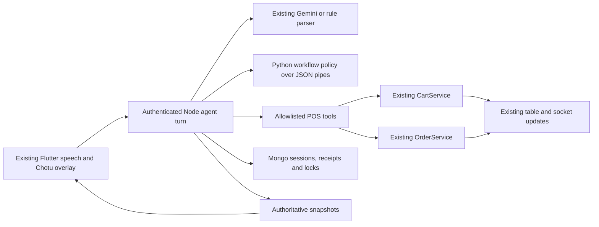

# Chotu architecture map

Generated: 2026-11-12. Scope: the order automation subsystem.

| Component | Location | Purpose |
| --- | --- | --- |
| Speech | `lib/core/services/speech_recognition_service.dart` | Existing speech input |
| Client adapter | `lib/core/services/chotu_service.dart` | Turn retries and snapshot application |
| Existing surface | `lib/features/pos/widgets/chotu_voice_sheet.dart` | Display returned feedback |
| API | `backend/src/routes/chotuRoutes.js` | Authenticated agent routes |
| Agent runtime | `backend/src/services/chotu/automationAgentService.js` | State, policy invocation and tool execution |
| Python bridge | `backend/src/services/chotu/pythonAgentBridge.js` | Bounded child process |
| Workflow policy | `backend/python/chotu_agent/agent.py` | Deterministic plan and clarification |
| Persistence | `backend/src/models/ChotuAgent*.js` | Session, turn receipt and writer locks |
| Existing tools | `backend/src/services/cartService.js`, `orderService.js` | Authoritative order lifecycle |

Legacy speech/parse/execute endpoints remain compatible. The new agent route
does not use the legacy success-message-only KOT/bill handlers. Technical debt:
legacy local-first behavior, manual POS/agent write races, hardware printer
acknowledgements, and payment-provider reconciliation remain outside this MVP.
