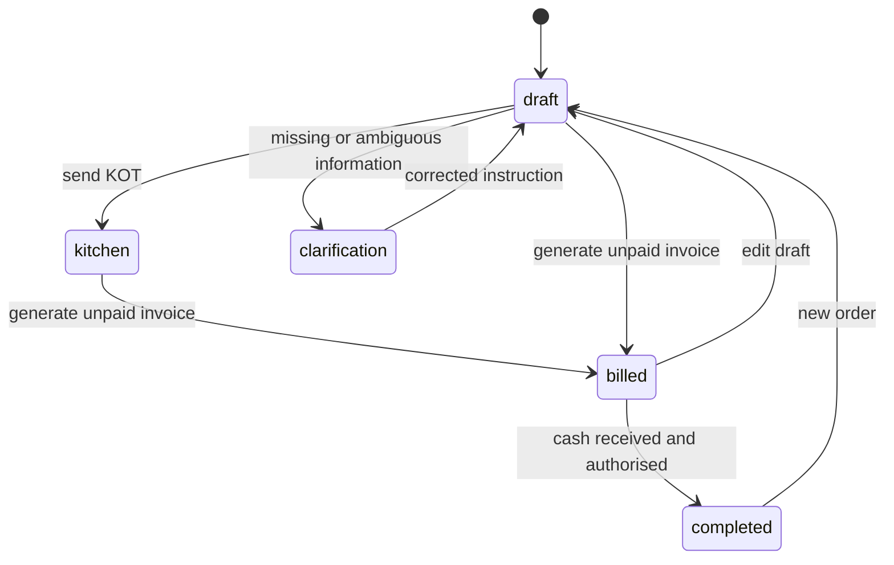

# Chotu AI — Technical requirements

Date: 2026-11-12 · Version: 1.0

## Architecture decision

Use a dependency-free Python 3.11+ planner called by Node through JSON on stdin
and stdout. Node executes a fixed tool allowlist through the existing cart and
order services. Python has no database credentials, network access requirement,
shell execution or authority to choose arbitrary functions. A separate Python
HTTP deployment is unnecessary for this version.

The optional existing Gemini parser interprets language; deterministic Python
policy controls workflow. An LLM response cannot set cash confirmation. Node
derives explicit confirmations from the current staff utterance and enforces
the actor's role again before settlement.

## Protocol

`POST /api/v1/chotu/agent/turn`, normal POS Bearer authentication:

```json
{
  "sessionId": "chotu-session-unique-to-device-and-user",
  "requestId": "stable-uuid-for-this-utterance",
  "text": "Table 5 pe do butter naan laga do",
  "currentTableContext": "T-5"
}
```

Business and user IDs come from authenticated middleware, never the body. The
endpoint accepts text, not a client-provided executable plan. Text is limited
to 2,000 characters, identifiers to 128 characters. A completed response uses
the normal API envelope and contains `status`, `stage`, `intent`, `chotuMessage`,
`sessionId`, `requestId`, executed `steps`, and authoritative cart/table/order
snapshots. Clarification is a successful transport response with zero steps,
not an executed action. `GET /agent/sessions/:sessionId` exposes the caller's
session and latest receipt for diagnosis.

The optional `expectedDrafts` list (at most 100 table drafts, 200 lines each)
contains the client's non-empty local draft IDs/quantities. The target draft
must match the server before any action; a mismatch preserves local state and
requires normal POS reconciliation. Expectations are part of the request hash.
The client may also supply expected actor/business IDs, which must equal the
verified session. They are comparisons only and never choose the actor or tenant.

Python input: `{command, context}`. Output: `{status, actions, message}`. Valid
actions are `add_items`, `remove_item`, `set_quantity`, `send_kot`,
`generate_bill`, `settle_cash`, `settle_payment`, `clear_draft`, and `view_order`. Context includes
cart count, existing order state and whether kitchen/bill fingerprints match.

## State and persistence



`ChotuAgentSession` has a unique `(businessId, userId, sessionId)` key, active
table, stage, pending confirmation, kitchen/bill fingerprints and order ID.
`ChotuAgentTurn` has a unique `(businessId, userId, sessionId, requestId)` key,
payload hash, processing/completed/review status, step receipts and response.
`ChotuAgentLock` uniquely locks `(businessId, resource)` for the session and
table. Locks have no automatic expiry: a crashed writer must be reconciled
before a replacement writer is allowed to mutate the same table.

Duplicate completed requests replay their JSON receipt after restart. Reusing
an ID with another payload is a conflict. Concurrent or interrupted requests
return conflict/review status. A tool failure after mutation starts retains the
table lock and a review receipt. Already completed steps remain visible. This
is deliberate uncertainty handling, not a distributed exactly-once guarantee.
Mongo writes across existing POS services are not one transaction; manual POS
edits do not participate in the agent lock. Fingerprints detect stale snapshots
at each agent turn; fully serialising manual POS writes is future work.

## Authoritative tools

- Resolve tables and products within `businessId`; reject missing/reserved tables.
- Re-resolve product IDs, stock, price, discount and tax on the server. Reject
  ambiguous variants/modifiers rather than dropping them.
- Validate the whole requested list before one cart replacement. Never add only
  the matched subset or manufacture a temporary product/price.
- Reuse `cartService.syncCart` and `clearCart`; no independent order database.
- Reuse `orderService.generatePosOrder` for KOT and
  `saveAndPrintOrder` for invoice snapshots. Guard empty carts first because the
  general POS services allow fallback items.
- Reuse `settleOrder` for confirmed Cash/UPI/Card equal to the authoritative
  invoice total; require that method to be enabled in business settings.
  Follow-up confirmations expire in two minutes and bind to the table, order ID,
  cart fingerprint and money values. Explicit partial amounts/split methods fail
  before any KOT, invoice or payment side effect.
- An issued manual bill can settle without repricing variants, discounts or
  round-off. Require unchanged persisted cart lines and preserve the local POS
  draft until settlement succeeds. New item/variant automation remains bounded.
- Derive tax from `Business.orderSettings.tax` and product tax percentage,
  including `no_gst` and zero-rated products. Round monetary values to cents.
- Reuse active table orders and stable order IDs. Do not select a restaurant's
  most recent takeaway order or create another order for the same table.
- Repeated unchanged KOT/bill actions reuse fingerprints. Draft edits clear
  billing validity. Reductions after kitchen submission require manual handling.
- Report snapshot creation separately from physical delivery to a printer.

## Permissions, failures and privacy

### Native print receipt dispatch (2026-11-16)

Successful turns return immutable `printJobs` keyed by PrintLog ID. KOT jobs
contain only quantities not in the previous kitchen snapshot. Completion returns
the paid receipt instead of printing both an unpaid invoice and a paid bill.
Flutter claims every job in SharedPreferences before printer I/O, serializes
concurrent dispatch, checks the original account scope and reuses the existing
Bluetooth/Windows printer service. Claimed/uncertain jobs are not auto-retried;
staff check the printer and use existing Orders reprint if needed. A true write
result means submitted to transport, not proof that paper physically printed.
Claims are device-local: only the initiating device dispatches the receipt;
session inspection on another device must not be used as a print command.

### Activation and recognition (2026-11-16)

The overlay starts recognition after access succeeds and resets partial speech
when leaving the foreground. A short native final-result grace avoids submitting
partial text ahead of a recognizer's final callback. Locale selection remains
available for Hinglish/Hindi/English. The versioned corpus in
backend/tests/fixtures/chotu_voice_commands.json covers ASR abbreviations,
Hindi payment/negation, compound table numbers and command verbs. This is
deterministic normalization and regression training material, not acoustic
fine-tuning or a claim of measured voice accuracy.

The authenticated main layout hosts opt-in, two-minute foreground standby.
Only a finalized exact Hello Chotu opens the overlay; extra ambient command
words do not execute. Navigation suspends standby; background, lock, logout and
scope changes stop it. TTS and wake capture do not overlap. Android ACTION_ASSIST
is a supported default-assistant entry; selection is done in system settings.
Cold and warm requests only open the gated overlay, expire after two minutes,
and wait for unlock. Power-button behavior is device/OEM controlled.

Continuous screen-off/background wake is not enabled. A separate native phase
needs an offline Hello Chotu keyword model, opt-in microphone foreground service
started while visible, persistent Stop notification, no boot auto-listening,
and real cafe-noise/battery/false-wake evaluation. Keep wake audio on device;
use allowed assistant entry or a notification tap for background activation.
Python remains the server planner, not an always-running Android microphone.
See Android SpeechRecognizer and foreground-service restrictions referenced in
VOICE_IMPLEMENTATION_PLAN_2026-11-16.md.

POS permission is required for order capture. Owner/admin/cashier is required
for settlement; body-supplied role or payment flags have no effect.
Missing runtime/provider/database causes an explicit failure. The new Flutter
path never falls back to local mutation after a POST may have executed.

The Flutter adapter persists a pending turn identity, text, table and draft
expectations, and scopes them
to business, user and API origin. It reuses the exact payload on retry, including
after reopening the app, and clears it after receiving a definitive receipt.
Order POSTs stay pinned to that origin and never use discovery or redirect
retries. Scope is rechecked after health discovery and before dispatch. A
returned snapshot cannot overwrite edits made during the request or after a
lost response; such changes require reconciliation. Agent draft precedence over
an older kitchen order is persisted with its order-item baseline, so navigation
and status-only kitchen updates preserve unsent additions. Immutable KOT
snapshots determine sent quantities; issuing a bill does not mark additions sent.
Snapshot items retain resolved product tax, including zero and non-GST rates.
Tokens and Gemini credentials never enter request receipts or the Python input.
Receipts retain the utterance and order snapshots in the restaurant's MongoDB;
retention/export policy should follow the restaurant's existing data policy.

## Runtime and configuration

- Existing Node >=18 runtime and installed backend dependencies.
- Python 3.11+ on the backend host. No pip dependency for the workflow planner.
- `CHOTU_AGENT_ENABLED=true` enables the new endpoint/UI path.
- `CHOTU_PYTHON_BIN` optionally names the Python executable; default is `python`
  on Windows and `python3` elsewhere.
- Existing Gemini configuration stays optional. Rule parsing works without a key.
- Child process uses an argument array, `shell: false`, a hidden Windows window,
  a five-second timeout and bounded JSON output.
- Health reports configured/available status. Disabling the flag rolls the
  frontend back to the existing flow after its next health check.

Relevant primary references: [Python JSON](https://docs.python.org/3.11/library/json.html)
and [Node child_process](https://nodejs.org/api/child_process.html#child_processspawncommand-args-options).
The existing microphone script is independent; it is not the order agent.

## Verification and rollout

Run Python policy tests, API integration tests against disposable MongoDB, and
focused Flutter service tests. Exercise real child-process invocation in backend
tests. Verify cart/order/invoice/sale/table records, restart-safe receipt replay,
stock changes, tenant/actor isolation, permissions, empty requests and partial
failure. Do not use production database credentials in tests.

Pilot with a configured Python host and test restaurant. Monitor receipt status
and reconcile every review outcome before removing its table lock. Production
deployment, real cash collection, noisy microphone trials and hardware printing
are not performed by this implementation task.
